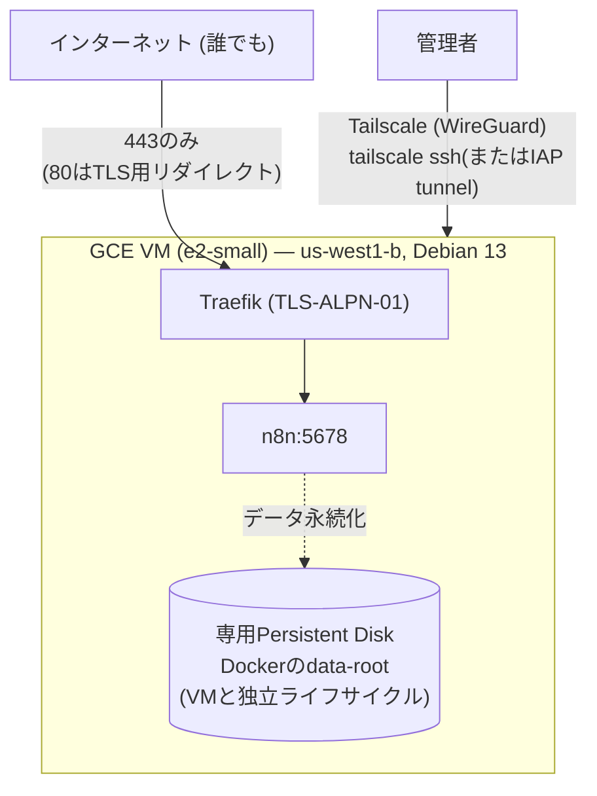

# n8n-ops

[English](README.md)

自分用のn8n(ワークフロー自動化)を、GCP Compute Engine(us-west1)上でセルフホスティングするためのインフラ一式。TerraformでGCPリソースを、GitHub ActionsでCI/CDを、Tailscaleで管理系アクセスを保護する。姉妹プロジェクト[vaultwarden-ops](https://github.com/kuchida1981/vaultwarden-ops)と同じ構成パターンを踏襲している。

- 公開URL: `https://n8n.u-rei.com`
- SSHはインターネットから直接到達できない。運用者は`tailscale ssh`か、IAP tunnel(`gcloud compute ssh n8n --zone us-west1-b --tunnel-through-iap`。CIもこの経路)を使う。プロジェクト全体に効いていたlegacyな`default-allow-ssh`は2026-11-26に無効化し、削除予定(`openspec/changes/remove-default-allow-ssh`)
- n8nの`/alive`監視ワークフローがvaultwardenの死活監視を担っており、n8n自身のデータ移行はこのワークフローの継続性に直結する
- データ永続化: 専用Persistent Disk上にDockerの`data-root`ごと配置し、named volume(`n8n_data`/`traefik_data`)をVMのライフサイクルから独立させる
- n8nイメージはリテラルタグで固定し、Dependabotが新バージョンを検知して更新PRを作成する
- バージョン更新の本番反映は`n8n-deploy.yml`(GitHub Environment承認ゲート付き)経由でのみ行われ、PRマージだけでは自動反映されない(詳細は「n8nのバージョン更新」参照)

## アーキテクチャ



Terraformは`terraform/bootstrap`(1回だけ手動apply)と`terraform/main`(GitHub Actionsが継続的にapply)の2段構成。

## vaultwarden-opsとの相違点

同じtailnet・同じGCPプロジェクト(`kuchida-devel`)を共有しているため、以下の点で単純な複製ではなく調整が入っている:

- **リージョン**: n8nもvaultwardenもus-west1で稼働している。GCP Compute Engine常時無料枠のe2-microはus-west1/us-central1/us-east1限定(請求アカウントあたり1台)で、n8nは有料のe2-small、vaultwardenが同じリージョンの無料枠e2-microを使う
- **リバースプロキシ**: vaultwardenはCaddyだが、n8nはTraefik(n8n公式サンプルの構成をそのまま踏襲したいため)
- **データ永続化の実装**: vaultwardenはdocker-compose.ymlをbind mountに書き換えているが、n8nはnamed volumeの構造を変えず、Dockerの`data-root`自体を専用ディスクへ向けている(理由は`n8n/docker-compose.yml`と`terraform/main/disk.tf`のコメント参照)
- **Tailscale ACL**: `tailscale_acl`リソースはtailnetの全ポリシーを単一リソースとして上書き管理するため、2つの独立したTerraform stateが同時にこのリソースを持つと、後からapplyした側が他方の設定を消してしまう。この事故を構造的に防ぐため、**ACLポリシーはu-rei-infraの`terraform/tailscale`が唯一のオーナーとして管理し、n8n-ops側は`tailscale_acl`リソースを持たない**(`tag:n8n-server`のtagOwners・SSHルールもu-rei-infra側で管理される)。n8n-ops側は`tailscale_tailnet_key`(認証キー)のみを管理する。tailnetに新しいサービスを追加する際は、そのサービス自身のリポジトリではなくu-rei-infraの`terraform/tailscale/acl.tf`にタグを追記する

## セットアップ手順

### 0. 前提

- GCPプロジェクトが作成済みで、課金が有効化されていること(vaultwarden-opsと同じプロジェクトを想定)
- ローカルに`gcloud` CLIと`terraform`(>=1.6)がインストール済みで、`gcloud auth application-default login`済みであること
- Tailscaleのtailnetに参加済みであること(vaultwarden-opsが既に使っているtailnetを再利用する)

### 1. Bootstrap(手動・最初の1回だけ)

`terraform/main`はGCSのリモートバックエンドとWorkload Identity Federation経由のGitHub Actions認証を前提にしているが、そのバケットとWIF Pool自体は「これから作る側」なので、ローカルから一度だけ手動で作成する。`terraform/bootstrap`自身のstateも(`terraform/bootstrap/versions.tf`で設定した通り)ローカルファイルではなく同じバケット内の別prefix(`bootstrap`)に保管するため、最後にapplyしたマシンに依存せず、マシンを跨いでも紛失しない。

**このプロジェクトに既にstateバケットが存在する場合**(既にbootstrap済みの環境に対して、IAM変更の反映などで再度applyする一般的なケース):

```bash
cd terraform/bootstrap
terraform init -backend-config="bucket=<既存のstateバケット名>"
terraform apply \
  -var="project_id=<your-gcp-project-id>" \
  -var="github_repo=<your-github-username>/<your-repo-name>"  # must exactly match the GitHub repo, e.g. kuchida1981/n8n-ops
```

**真にゼロから新規GCPプロジェクトで初めてbootstrapを実行する場合**(バケットがまだ存在せず、`terraform init`がbackendの向き先を持てない)は、代わりに一度きりの「ローカル実行→migrate」手順を踏む:

```bash
cd terraform/bootstrap

# 1. versions.tf の `backend "gcs" { ... }` ブロックを一時的にコメントアウトし、
#    この最初の1回だけローカルstateでバケット自体を作成する。
terraform init
terraform apply \
  -var="project_id=<your-gcp-project-id>" \
  -var="github_repo=<your-github-username>/<your-repo-name>"

# 2. `backend "gcs" { ... }` ブロックを元に戻し、直前のapplyが作成した
#    バケットへ、そのstateを移行する。
terraform init -backend-config="bucket=$(terraform output -raw state_bucket)" -migrate-state
```

いずれの手順でも、apply完了後は以下のoutputを控える(次のGitHub Secrets登録で使う):

```bash
terraform output
# state_bucket
# workload_identity_provider
# terraform_ci_service_account_email
```

**既存環境をアップデートする場合**: `terraform/bootstrap`はGitHub Actionsではなく手動apply専用のため、CI用サービスアカウントのIAM権限(例: `n8n-deploy.yml`用に追加した`roles/iap.tunnelResourceAccessor`・`roles/compute.osAdminLogin`)が変更されたときは、同じ`terraform apply`コマンドを再実行して反映させる必要がある。差分のみが適用され、既存リソースは壊れない。stateはGCS上にあるため、どのマシンからでも`terraform init -backend-config="bucket=<state_bucket>"`でstateに再接続すればよく、最後にapplyしたマシンである必要はない。

**planは自動化されているが、applyはされていない**: `.github/workflows/terraform-plan.yml`は、すべてのPR(dependabotによる週次providerバージョンアップPRを含む)に対して`terraform/bootstrap`への`terraform plan`を実行し、結果をコメントする。`terraform/main`と同じ読み取り権限を持つCI用サービスアカウントを使う。一方`terraform-apply.yml`は**意図的に`terraform/bootstrap`を対象外にしている**: このディレクトリはCI用サービスアカウント自身・そのWorkload Identity Federation Pool・そのSA自身へのproject IAMバインディングを作成する構成であり、CIがこれをapplyできると、そのIDが自分自身により広い権限を無監督で付与できてしまうため。CIが投稿したplanをレビューした上で、上記の通り手動で`terraform apply`することが、`terraform/bootstrap`への変更を反映する唯一の方法であることに変わりはない。

### 2. Tailscale OAuthクライアントの発行(手動)

https://login.tailscale.com/admin/settings/oauth で、このリポジトリ専用のOAuthクライアントを**Auth Keys (write)スコープのみ**で発行し、タグを`tag:n8n-server`に限定する。**Policy Fileスコープは付けない**(ACLはu-rei-infraが所有しており、ポリシー書き込み権限の認証情報をこのリポジトリに置かないのは意図的)。

apply前に、u-rei-infraの`terraform/tailscale/acl.tf`(このtailnetのACLポリシーの唯一のオーナー)に`tag:n8n-server`のtagOwners・SSHルールが既に含まれているか照合すること。含まれていない場合は、先にu-rei-infra側でそのエントリをマージ・applyしてから本リポジトリのapplyに進む。

### 3. GitHub Actions Secretsの登録

このリポジトリの Settings → Secrets and variables → Actions に、以下を登録する:

| Secret名 | 値 |
|---|---|
| `GCP_PROJECT_ID` | GCPプロジェクトID |
| `GCP_WORKLOAD_IDENTITY_PROVIDER` | bootstrapのoutput `workload_identity_provider` |
| `GCP_SERVICE_ACCOUNT_EMAIL` | bootstrapのoutput `terraform_ci_service_account_email` |
| `TF_STATE_BUCKET` | bootstrapのoutput `state_bucket` |
| `TAILSCALE_OAUTH_CLIENT_ID` | 手順2で発行(または再利用)したClient ID |
| `TAILSCALE_OAUTH_CLIENT_SECRET` | 手順2で発行(または再利用)したClient Secret |
| `TAILSCALE_TAILNET` | 自分のtailnet名 |

**重要**: これらはリポジトリにコミットしない。すべてGitHub Actions Secretsとしてのみ保持する(このリポジトリは公開リポジトリなので特に注意)。

### 4. GitHub Environmentの承認ゲート設定(手動)

`terraform-apply.yml`ワークフローは`environment: production`を参照しているが、実際に人間の承認待ちで停止させるprotection ruleはワークフローYAMLだけでは設定できない。このリポジトリの Settings → Environments → New environment で `production` を作成し、"Required reviewers" に自分自身(または信頼できるレビュワー)を追加する。

### 5. Phase A: テストサブドメインでの初回apply

`terraform/main/variables.tf`の`domain`変数はデフォルトで`n8n-test.u-rei.com`を指すようになっている。`main`ブランチへのマージ後、GitHub Actionsの`terraform apply`ワークフローが承認待ちで停止するので、GitHub上で承認する。初回applyでVM・静的IP・ファイアウォール・データディスク・Secret Manager・Tailscale認証キーが一括作成される(ACLポリシー自体はvaultwarden-ops側で管理済みである必要がある。手順2参照)。

apply完了後、出力された静的External IPを使い、`u-rei.com`のDNS管理画面で`n8n-test.u-rei.com`のAレコードを手動作成する。

以下を確認する:
- `https://n8n-test.u-rei.com`でLet's Encrypt証明書が有効になっており、n8nの初期セットアップ画面が表示される
- `tailscale ssh n8n`でVMに接続できる。端末がtailnetのポリシーで許可されていない場合は`gcloud compute ssh n8n --zone us-west1-b --tunnel-through-iap`
- `free -h`/`swapon --show`でswapが有効
- VM再起動後もstartup-scriptの再実行で二重処理が起きない

### 6. Phase B〜E: 本番データ移行とカットオーバー

Phase Aの検証が済んでから着手する。ダウンタイムは許容する前提。

1. 旧VM(`n8n-debian`, us-west1-b)で`docker compose down`
2. 旧VMの`n8n_data`ボリューム配下全体(`config`, `database.sqlite`, `binaryData/`, `nodes/`, `ssh/`, `storage/`等)をtailscale経由のrsync/scpで新VMのDocker data-root配下へコピー
3. 新VM上で`docker compose down && docker compose up -d`し、コピーしたデータでn8nが起動することを確認
4. n8nエディタで既存ワークフロー・credentialsが表示されること(encryptionKeyが正しく引き継がれている証拠)を確認
5. `terraform/main/variables.tf`の`domain`のデフォルト値を`n8n.u-rei.com`に変更してPR→承認→apply
6. `n8n.u-rei.com`向けの新しいTLS証明書が発行されるのを待ち、DNSのAレコードを新VMの静的IPへ切り替える
7. vaultwardenの`/alive`監視ワークフローが正常にDiscord通知を送れることを確認する
8. 問題がなければ旧VM(`n8n-debian`)とそのディスクを削除する

## n8nのバージョン更新

n8nイメージは`n8n/docker-compose.yml`でリテラルタグ固定しており、更新は以下の2段階の承認を経て反映される。即時反映は意図しておらず、月1回程度の更新頻度を想定している。

1. **バージョンを受け入れる**: Dependabotがn8nの新バージョンを検知すると、`n8n/docker-compose.yml`のタグ更新を提案するPRを自動作成する(n8nイメージは`n8nio/n8n`という暗黙のDocker Hub参照で記述しており、Dependabotが認証情報なしで検知できる。`docker.n8n.io`独自レジストリを直接参照する構成は、Dependabotの`docker-registry`タイプが`username`/`password`を必須とするため採用していない)。PRをレビューし、`main`へマージする
2. **今このタイミングで反映する**: マージをトリガーに`n8n-deploy.yml`が起動し、`production` Environmentの承認待ちで一時停止する。承認すると、CIランナーがGCP IAP tunnel経由でVMへSSHし、`git pull && docker compose pull && docker compose up -d`を実行する。VM自体の再起動は行わないため、Traefikの証明書(`acme.json`)には影響しない

反映後は、対象のn8nバージョンで実際にワークフローが動作していること(vaultwardenの`/alive`監視ワークフロー含む)を確認する。

## セキュリティログ

攻撃の痕跡は、VMの外にあるCloud Loggingに保存する。VMを再作成しても残り、VMが侵害されても消されない。アラート・通知は意図的に未整備(`add-security-logging`のスコープ外)。

| 内容 | ログ名(`log_id`) | 備考 |
|---|---|---|
| Traefikのアクセスログ、n8n/Traefikのコンテナ出力 | `docker_containers` | JSON形式のアクセスログ。`jsonPayload.attrs."com.docker.compose.service"`が`traefik`か`n8n` |
| ホストのjournal(sshd、tailscaled、docker、sudoなど) | `host_journal` | `_SYSTEMD_UNIT`でユニット単位に判別できる |
| Secret Managerの読み取り(Data Access監査ログ) | `cloudaudit.googleapis.com/data_access` | どのシークレットを誰が読んだか |

この3つは専用の`security-logs` bucketにも複製され、`security_log_retention_days`(既定**90日**、`terraform/bootstrap/variables.tf`)保持される。`_Default`(30日)にも残る。Admin Activity監査ログはGCPの仕様で400日保持される。VMの`/var/log/syslog`はOps Agent標準のreceiverが`syslog`として送る(30日のみ。同じ事象は`host_journal`にも入る)。

クエリ例(Logs Explorerまたは`gcloud logging read`):

```
# 4xx/5xxになったリクエスト
log_id("docker_containers") AND jsonPayload.DownstreamStatus>=400

# 特定のクライアントIP
log_id("docker_containers") AND jsonPayload.ClientHost="203.0.113.9"

# SSH総当たりの試行
log_id("host_journal") AND jsonPayload.SYSLOG_IDENTIFIER=~"sshd" AND jsonPayload.MESSAGE=~"Invalid user|Failed password"

# シークレットの読み取り
log_id("cloudaudit.googleapis.com/data_access") AND protoPayload.serviceName="secretmanager.googleapis.com"
```

知っておくこと:

- **200は探索の成功を意味しない。** n8nはSPAのため、存在しないパス(`/.env`、`/.git/config`など)にも200でトップのHTMLを返す。成否はステータスではなく、応答のサイズや内容で判断する。
- **クエリ文字列はログに残る。** Traefikの`RequestPath`にはクエリ文字列が含まれる(例: `/rest/push?pushRef=...`)ため、クエリで渡した秘密はそのまま記録される。ヘッダは既定でdropし、`Authorization`/`Cookie`/`Set-Cookie`はredactにも設定している(実測で`REDACTED`と記録されることを確認済み)。ログの閲覧がプロジェクトオーナーに限られることを理由に、許容した。
- **Dockerのログローテーションは、新しく作られたコンテナにしか適用されない。** startup-scriptが`/etc/docker/daemon.json`を変更したあと、既存のコンテナは一度作り直す必要がある: `cd /opt/n8n/app/n8n && sudo docker compose --env-file /opt/n8n/.env up -d --force-recreate`。確認は`sudo docker inspect -f '{{.Name}} {{.HostConfig.LogConfig.Config}}' $(sudo docker ps -q)`。
- 監査設定・log bucket・sinkは`terraform/main`ではなく`terraform/bootstrap`にある。監査設定がプロジェクトのIAMポリシーを書き換えるため、CI用サービスアカウントには意図的に許可していないことによる。プロジェクトはvaultwarden-opsと共有なので、これらはこちらだけが所有する。

## セキュリティアラート

Cloud Monitoringは、行動が必要な事象だけをメールする(探索や総当たりは記録するが通知しない)。定義は`terraform/bootstrap/alerting.tf`で、手元でapplyする。通知先と運用者のアドレスはsensitiveな変数(`TF_VAR_alert_email`、`TF_VAR_operator_email`。CIのplanはSecretsの`ALERT_EMAIL`/`OPERATOR_EMAIL`を使う)。

| アラート | 鳴る条件 | 確認すること |
|---|---|---|
| n8n: 想定外のSSHログイン | IAP経由のCI・運用者以外のログインがsshdで成功した | ログのユーザーと送信元IP |
| Secret Manager: 想定外の主体 | 許可リストにない主体がシークレットを読んだ | 主体とシークレット。心当たりがなければ権限を剥奪して作り直す |
| GCP: ファイアウォール・IAMの変更 | 実行者を問わず、ルールかIAMポリシーが変わった | 自分の操作やTerraformのapplyと一致するか |
| n8n: ログイン失敗の連続 | 10分間に5回以上の失敗(401/429) | アクセスログのクライアントIP |

Terraformのapplyの後には、ファイアウォール・IAMのメールが届く。対象外: Tailscale SSHのログイン、ログ収集エージェントの停止、Vaultwarden固有の事象。

## ロードマップ(本リポジトリの現時点のスコープ外)

- セキュリティアラートのDiscordへの通知(まずはメール。`add-security-alerting`の後続)
- Vaultwarden固有の事象(ログイン失敗)へのアラートの展開(n8nで実績を作ってから)
- Tailscale SSHの扱いの整理(`tailscale ssh`は使えた実績がなく、アラートの対象外。使えるようにするか、無効にするか)
- NASへの自動バックアップ(vaultwarden-opsの`add-nas-backup`パターンをn8n向けに展開する、次の別change)
- GCPプロジェクト全体に効いているlegacyな`default-allow-rdp`ファイアウォールルールの整理(`default-allow-ssh`は`remove-default-allow-ssh`で対応)
- リバースプロキシのCaddyへの統一(Traefikの現状維持を優先しているが、将来検討)

## ディレクトリ構成

```
terraform/bootstrap/  … 手動・1回だけapply。GCS state bucket, WIF Pool, CI用SA
terraform/main/       … GitHub Actionsが継続的にapply。VM/FW/Disk/Secret Manager/Tailscale認証キー(ACLポリシー自体はu-rei-infra側が唯一のオーナー)
n8n/                   … docker-compose.yml(Traefik + n8n)
.github/workflows/     … terraform plan(PR、terraform/main・terraform/bootstrapの両方が対象) / apply(main, 承認ゲート付き、terraform/mainのみ) / n8n-deploy(n8n/配下の変更、承認ゲート付き)
```
